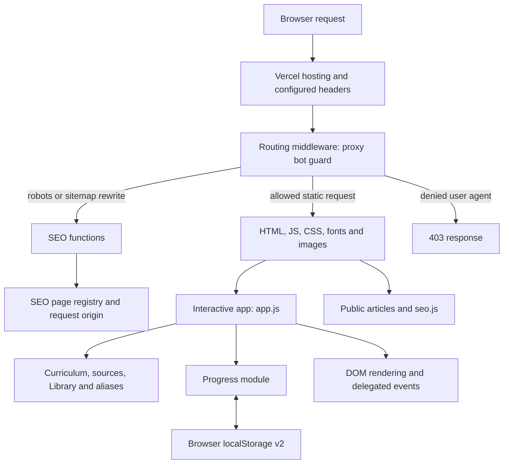

# Architecture and maintainer guide

Verified against the working tree on 2026-11-12. This describes the current implementation. [UI/UX recommendations](UI_UX_RECOMMENDATIONS.md) describe proposed future changes.

## System at a glance

Learn Pickleball is a static, browser-rendered learning app with separately authored public articles. It uses native JavaScript modules, HTML, and CSS—not React, a bundler, or a server-rendered framework. Vercel supplies hosting, request middleware, and two SEO response functions. Learning progress stays in browser local storage; there is no application account service, database, or progress API in this codebase.



The diagram groups infrastructure responsibilities; it is not a claim about the platform's exact internal processing order. Hash fragments are handled in the browser and are not sent to the server. Static local preview does not run the Vercel layer.

## Layers and ownership

| Layer | Owning files | Responsibility and boundary |
|---|---|---|
| App shell and presentation | [index.html](../index.html), [styles.css](../styles.css) | Loads the module, fonts/styles, skip link, storage notice, and live toast region. CSS handles responsive navigation and reduced motion. |
| Routing, rendering, interactions | [app.js](../app.js) | Parses hash routes, renders HTML strings into `#app`, handles delegated actions, selects the next lesson, enforces gates, and awards keepsakes. UI and domain orchestration currently share one module. |
| Learning content | [content/curriculum.js](../content/curriculum.js) | Seven units, 29 lessons (20 core), page/activity data, prerequisites, sources, entry routes, Library records, and old lesson aliases. Stable IDs connect content to persisted progress. |
| Local state | [content/progress.js](../content/progress.js) | Fresh state, normalization, storage access, page completion, attempts, and practice logs. It does not render UI or decide lesson availability. |
| Public discovery | [learn-pickleball/](../learn-pickleball/), [public.css](../public.css), [seo.js](../seo.js) | Static article content and metadata, with links into interactive lessons. Browser script adjusts canonical/social URLs to the current origin and adds JSON-LD. |
| SEO responses | [api/robots.js](../api/robots.js), [api/sitemap.js](../api/sitemap.js), [api/seo-pages.js](../api/seo-pages.js) | Plain-text robots and XML sitemap, sharing a six-URL registry including `/`. No learner state is involved. |
| Hosting and request policy | [vercel.json](../vercel.json), [middleware.js](../middleware.js), [proxy.js](../proxy.js) | Validation build, root static output, rewrites, security headers, and user-agent guard. Dashboard configuration is a separate operational concern. |
| Assets and checks | [assets/](../assets/), [scripts/](../scripts/), [package.json](../package.json) | Local images/fonts and executable integrity checks. The only declared package dependency is `@vercel/functions`; the lockfile pins installation resolution. |

### Browser flow

1. `index.html` loads `seo.js` and the `app.js` ES module. The app imports curriculum and progress helpers and loads normalized v2 state.
2. `render()` reads the hash, selects a screen, replaces `#app.innerHTML`, stores `lastViewedRoute`, updates the title, and optionally focuses the main region. A saved route is a record, not automatic full-session restoration.
3. Document-level click/input/keyboard handlers read `data-action` attributes. Actions update in-memory state, persist meaningful progress, and render again. `hashchange` clears transient answer selections and renders with main focus.
4. Completing all required lesson pages marks the concept understood. Optional references and voluntary practice do not block concept completion. Correct answers record completion; reading pages use an explicit completion action.
5. Next-lesson selection tries the active playlist, then a recommended unit, then the remaining available lessons. Prerequisites and diagnostic access govern availability. Completed lessons remain reviewable.

Unit disclosure choices are retained in session storage with an in-memory fallback; the Back to path link returns focus to the lesson row. Other DOM-local focus state is not automatically durable. Keep escaped text interpolation and accessible focus behavior intact when adding renderers. User-facing strings and content are currently English; there is no localization framework.

### Routes and compatibility

| Canonical route | Purpose |
|---|---|
| `#/` | New-user landing or returning recommendation, depending on selected entry route |
| `#/placement` | Four entry choices; consistency route includes a five-question diagnostic |
| `#/learn` | Expandable seven-unit course |
| `#/lesson/<id>?page=<page-id>` | Generic lesson renderer; without a valid page selection, chooses the first incomplete required page, or the first page when complete |
| `#/practice` | Optional practice logging |
| `#/court-lab` | Court exploration, serve/kitchen scenarios, and knowledge check |
| `#/library?view=skills` / `?view=rules` | Visual skills or rules/guides search and filtering |
| `#/progress` | Completion, practice, keepsakes, and reset |

Compatibility routes: `#/home` opens home; `#/court` and `#/quiz` open Court Lab; `#/skills` and `#/resources` open Library (Resources defaults to rules); `#/achievements` opens Progress. Old lesson IDs resolve through `legacyLessonAliases`; some choose the first unfinished replacement lesson. Canonical IDs take precedence. An alias can still lead to a locked lesson: compatibility does not bypass prerequisites. Unknown routes/lessons show recovery links.

**Link compatibility is not data migration.** Keep aliases when renaming curriculum IDs, and separately design any progress migration. Do not assume every path mentioned by a helper is a supported screen: the route dispatch in `render()` is authoritative.

### Progress and failure behavior

`STORE_KEY` is **`learn-pickleball:v2`**, with schema version **2**. State includes route/placement choices, per-lesson required and optional pages, attempts, concept status, practice logs, Court Lab state, earned sticker IDs, and the last viewed route.

- Storage is origin-specific and browser-specific; there is no sync, backup/export UI, or server copy. Preview and production origins have different stores. Opt-in `?study=baseline`, `?study=discovery`, and `?study=atlas` research conditions use separate progress and session disclosure keys; see the [validation guide](UX_VALIDATION.md). Their v2 schema and lesson gates remain the same.
- Loading catches storage/JSON errors and returns fresh state. Normalization rejects incompatible versions and unknown lesson IDs and sanitizes selected fields; it is not comprehensive schema validation.
- v1 data is neither imported nor deleted. Reset clears v2 and rendering persists a fresh v2 record; older keys remain untouched.
- Failed writes return `false` and expose the storage notice. In-memory use continues in the current page, but a reload can lose changes. A read failure by itself does not guarantee the write-failure notice appears.
- Required-page progress and attempts persist; current answer selections, Library query/filter state, active court feedback, and modal state are transient; unit disclosure choices live only for the browser session. Reload is not exact visual-session restoration.
- Court Lab completion requires visits to kitchen, service, and baseline plus the correct map check. That gate also completes linked Court Lab lesson pages. Normalization invalidates earlier v2 exploration-only completion.
- Selected concept completions award keepsakes; not every lesson has a sticker. Practice records are separate from concept completion and are not a skill rating.

No service worker or offline app cache is implemented. Local progress persistence should not be described as guaranteed offline availability.

## Hosting, SEO, and infrastructure

Vercel configuration uses `framework: null`, `buildCommand: npm run check`, and `outputDirectory: .`. The build validates source; it does not compile a bundle or generate a separate distribution folder. Treat deployable repository content as potentially public and inspect deployment contents before publishing internal artifacts. `.gitignore` controls Git tracking, not a universal hosting access policy.

`middleware.js` re-exports the guard from `proxy.js` and matches all paths. The guard returns a no-store 403 for its explicit automation user-agent patterns, otherwise calls `next()`. It deliberately avoids generic “bot” matching, but includes common headless/automation clients, which can affect deployed browser tests. It is neither authentication nor robust protection against spoofed user agents.

Configured headers restrict scripts/styles/fonts/network connections to the same origin, disallow framing and objects, disable selected device permissions, prevent MIME sniffing, and set referrer and cross-origin policies. Inline or third-party assets may require policy changes; inspect the browser console before weakening a policy to make a feature work.

`/robots.txt` and `/sitemap.xml` rewrite to functions. They derive an origin from forwarded/host headers, constrain the protocol and host format, and fall back to `https://localhost` for invalid/missing hosts. Responses use a one-hour shared-cache lifetime with stale-while-revalidate. The sitemap registry and `updated` dates are maintained manually.

Public HTML pages are independently authored, not generated from the curriculum. Keep article wording, canonical lesson links, source references, and metadata aligned when content changes. Static metadata contains a fallback production origin; `seo.js` rewrites some URLs only after JavaScript executes. Verify raw HTML as well as rendered metadata when changing domains.

### Operational responsibilities

| Responsibility | Repository provides | Maintainer must verify outside the code |
|---|---|---|
| Deployment | Build/output configuration and lockfile | Vercel project linkage, branch, Node runtime, domain/DNS, actual deployed revision |
| Request protection | User-agent guard and headers | Dashboard Bot Management, AI-bot policy, firewall/rate limits, and preview access policy |
| Search discovery | Public HTML, robots/sitemap functions | Production canonical URLs, crawler access, Search Console/Bing registration and sitemap submission |
| Release health | Local checks | Preview/browser smoke tests, deployment logs, and production error responses |

Dashboard settings are not proven by configuration files or README instructions. No dedicated application analytics or error-reporting SDK is wired into the inspected app. A secret-scan workflow is also present under `.github/workflows/`; verify its remote execution separately. Its presence does not establish that the application checks run in GitHub CI.

## Local setup and maintenance

Use Node/npm for checks and Python 3 (or another static server) for preview. The package does not declare a Node engine version; align your local Node version with the verified Vercel runtime rather than assuming a pinned version.

```sh
npm ci
npm run check
python3 -m http.server 4173 --bind 127.0.0.1
```

Open `http://127.0.0.1:4173/`. The static server supports the app and public HTML, but not Vercel middleware, response headers, function rewrites, or dashboard rules. Verify those through an authorized Vercel preview. No application credentials are needed for basic static preview.

### Checks and their limits

`npm run check` is the current build gate. It performs JavaScript syntax checks and runs proxy, SEO, font, sticker, curriculum, and app-v2 checks. These include content integrity, progress helper behavior, legacy alias expectations, source-level rendering contracts, and focused P1 summary, filter, evidence, and storage-fallback checks. They are not a full browser integration suite or accessibility certification.

The older `check-learning-flow.mjs` and `check-learning-runtime.mjs` scripts target earlier app structures and are not part of that gate. Do not treat every script in `scripts/` as an actively supported v2 test command.

For UI changes, additionally exercise fresh/partial/complete progress, locked and legacy links, storage failure, Court Lab gates, modal focus, keyboard input, small screens, zoom, reduced motion, and failed images. For infrastructure changes, verify live headers, allowed/denied request behavior, and robots/sitemap responses. Use `git diff --check` for documentation and patch hygiene.

### Where to make common changes

| Change | Work path and checks |
|---|---|
| Add or revise a lesson | Update curriculum data, unique lesson/page IDs, prerequisites, source IDs, and art. Reuse a supported activity renderer or add an explicit branch in the app. Run curriculum/app checks and complete the lesson manually. |
| Rename or remove content | Preserve legacy aliases and assess stored IDs/page completion before editing. A renamed ID can disappear during normalization; aliases alone do not move progress. |
| Change completion or storage | Separate rendering rules from progress helpers, define compatibility behavior, and test fresh, saved, malformed, unavailable, and reset cases. |
| Change navigation or layout | Update route dispatch, header/mobile active state, titles, focus behavior, and CSS together. Exercise direct and legacy URLs. |
| Add a public article | Author HTML and metadata, update the SEO registry, connect canonical interactive links, and run SEO checks. Verify both raw and rendered page output. |
| Replace artwork or fonts | Follow the [illustration guide](ILLUSTRATION_STYLE_GUIDE.md), [generation recipe](IMAGE_GENERATION_PROMPTS.md), and [visual inventory](PICKLEBALL_VISUAL_CURRICULUM.md). Keep font licenses and useful alt text. WebP copies exist, but current curriculum references often use PNG; existence alone does not mean optimized assets are served. |

Keep this guide synchronized when routes, schema, deployment configuration, or the validation gate change. Content source review dates describe editorial records; this document does not independently certify the current accuracy of sports rules or linked external sources.
